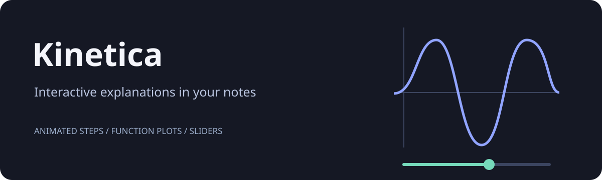
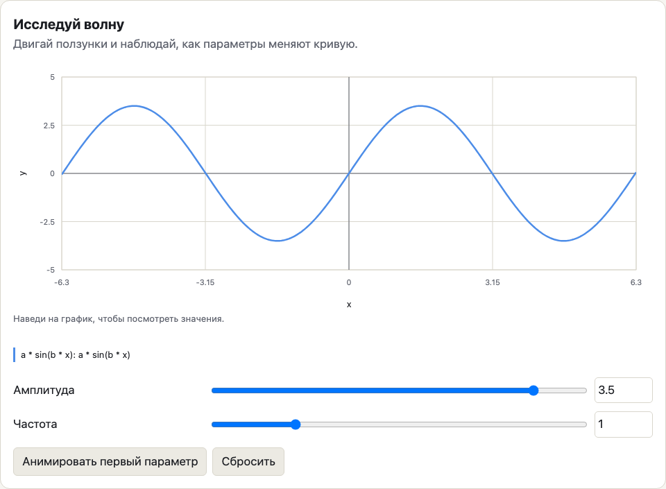

# Kinetica



[](https://github.com/MrBenoit/Kinetica/actions/workflows/check.yml)
[](LICENSE)

Create visual explanations inside Obsidian: step-by-step diagrams and function plots that respond to sliders. Start from a template and use the editor to build an explanation without writing JavaScript.

Kinetica is an early beta. It has not been submitted to the Obsidian community directory. Desktop use has been tested on macOS; mobile testing is still needed.

[Get started](#install-the-beta) | [Examples](examples/) | [Contributing](CONTRIBUTING.md)



The example above shows the Russian interface. English is also supported.

## Create your first visualization

1. Open the command palette and run **Kinetica: Create visualization**, or click the workflow icon on the ribbon.
2. Pick a scene or graph template.
3. Edit the title and content. In a scene, drag blocks, add arrows and duplicate a step to create the next state. In a graph, enter formulas and define parameters for sliders.
4. Click **Save to note**. A new Markdown note appears in the current note's folder.
5. View it in Reading view or Live Preview. Click **Edit** to reopen the visual editor.

**Add visualization to current note** appends a new block to the active note. **Edit visualization in current note** works from source mode too and offers a chooser when there are several visualizations.

The interface follows Obsidian's language, with English and Russian supported. You can override the language in settings. Reopen notes after changing it; reload the plugin to refresh command names.

## Scenes

- Blocks with a label, value, color and highlight
- Drag positioning, arrow-key movement and numeric coordinates
- Directed arrows with labels
- Steps with an explanation and code excerpt
- Duplicate, reorder or delete steps
- Play, pause, back, next, restart, speed and direct step selection
- Smooth position changes between matching block IDs
- Undo and redo in the editor, plus a discard confirmation

Each step stores its own state. Editing a block changes the current step only. Duplicate the current step, then move objects or change values to describe what happens next. New objects appear immediately; existing objects animate between positions. The code excerpt changes with the step; syntax highlighting and line-by-line code selection are not included.

The canvas uses an 800 by 440 coordinate space. A block is 140 by 74 units. The initial version supports rectangular blocks and straight arrows. It is not a general drawing application.

## Graphs

Enter formulas such as `a * sin(b * x)`, `exp(rate * x)` or `1 / x`. Define `a`, `b` or `rate` in the slider editor. The player recomputes the graph locally as a slider moves.

- Up to 8 curves and 12 parameters
- Named axes and explicit axis ranges
- A slider and numeric input for each parameter
- Curve values under the pointer
- Animate the first parameter from minimum to maximum, pause or reset
- Reduced-motion support for transitions

Operators: `+ - * / ^`, parentheses and unary signs. Power is right-associative: `2^3^2` means `2^(3^2)`. `-2^2` means `-(2^2)`.

Functions: `sin`, `cos`, `tan`, `asin`, `acos`, `atan`, `sqrt`, `abs`, `exp`, `log`, `ln`, `log10`, `floor`, `ceil`, `round`, `min`, `max`, `pow`. Trigonometry uses radians; `log` and `ln` are natural logarithms. Constants: `pi`, `e`. Use `*` for multiplication, including `2 * x`.

Parameter names start with a letter and use letters, digits or underscores. Function names, `x`, `pi` and `e` are reserved. A slider only changes a curve if that parameter appears in the formula. Preview slider changes are temporary. Change **Initial value** in the editor to save a different starting value.

Plots sample 401 points across the X range. Undefined results are omitted and large jumps are split. This is an educational plotter, not a numerical solver: very narrow features and discontinuities between samples can be missed. Resize the axis range to inspect them.

## Portable documents

A visualization is versioned JSON inside a `motion` fenced code block in the note. Copying the note copies the full visualization; there are no hidden asset dependencies. Recipients need Kinetica to view the interactive version. With the plugin disabled, the note retains its readable source data.

The editor can import JSON from another user or an assistant. Imported documents receive a fresh ID. If you manually duplicate a block inside the same note, give its `id` a new value before editing either copy. Use top-level fenced blocks for visual editing; editing blocks nested in blockquotes is not supported in this version. The editor refuses to save when it detects a duplicate ID or a conflicting edit to that visualization. Unrelated edits to the surrounding note are preserved.

Examples are in [examples/](examples/). Documents must contain `version: 1`, a unique `id`, `type`, `title` and `description` plus fields for that type. Limits are 100 steps, 64 blocks and 128 arrows per step, and 500,000 characters in the serialized block. Label and expression limits are checked before rendering.

No JavaScript or HTML from a document is executed. Formulas are parsed by a restricted mathematical interpreter; they cannot access files, the network or JavaScript objects. Unknown functions and parameters produce validation errors.

## Install the beta

Download the three plugin files from [GitHub Releases](https://github.com/MrBenoit/Kinetica/releases) when a release is available. You can also build them locally with the development commands below.

1. Place `main.js`, `manifest.json` and `styles.css` in `<vault>/.obsidian/plugins/kinetica/`.
2. Reload Obsidian and enable **Kinetica** under **Settings > Community plugins**.
3. Copy an example note into the vault, or run **Create visualization**.

Minimum API version: Obsidian 1.8.7. Live desktop verification was performed on Obsidian 1.14.4 for macOS. The code avoids Node/Electron APIs and adapts to narrow screens, but mobile devices and other desktop operating systems have not been tested yet. Validation details remain in English when the Russian interface is selected.

This plugin runs offline. It uses no accounts, remote services, telemetry or external scripts. It reads and writes the notes you create or edit, and saves its language setting in its own plugin directory.

## Development

Use Node.js 22. Install and run checks:

```sh
npm ci --ignore-scripts
npm run check
```

`npm run dev` rebuilds JavaScript on changes. Run `npm run build` after changing styles or manifest too. The installable files are written to `dist/`. Reload the plugin in a test vault after copying them there.

`src/model.ts` owns document validation and conflict-aware replacement. `src/expression.ts` parses math. `src/player.ts`, `src/plot.ts` and `src/draw.ts` render without the Obsidian API. `src/editor.ts` owns editable drafts and history. `src/main.ts` adapts those components to commands, Markdown rendering and vault storage.

Tests cover expression parsing, invalid input, serialization, concurrent edit protection, playback, slider behavior, editor history and failed saves. CI runs formatting, lint, tests and the production build. It uploads a build artifact; it does not publish releases.

## Distribution

See [RELEASING.md](RELEASING.md) for build, release and community-directory submission steps. The release tag must match the manifest version without a `v` prefix, currently `0.1.0`.

Follow the current [Obsidian submission guide](https://docs.obsidian.md/Plugins/Releasing/Submit%20your%20plugin) for community-directory submission. No repository, release or submission is created by the build scripts.

The step-by-step interaction was inspired by the author's Voidlearn textbook. This plugin uses its own portable document format and renderer; it does not include the textbook's 292 scenes or execute their TypeScript modules.
